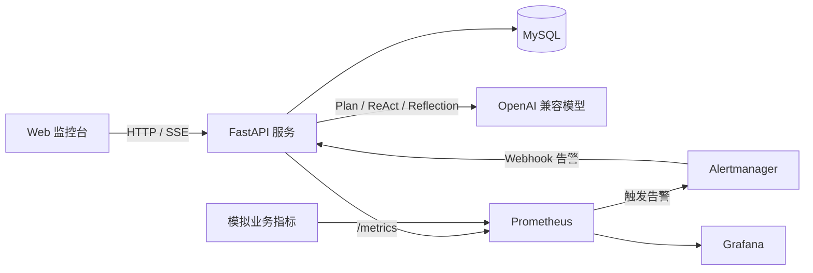

# SRE On-Call Agent

> AI 驱动的 SRE 值班助手：告警分诊、根因调查、故障复盘报告自动生成

> **项目简介**：本项目构建了一个 AI 驱动的 SRE 值班助手，自动完成告警分诊、根因调查和故障复盘报告生成。通过三阶段智能体流水线（Plan-and-Solve → ReAct → Reflection）演示了三种经典范式在真实运维场景下的串联应用，是 SRE/运维领域的教学实践项目。

## 📝 项目介绍

凌晨 3 点生产告警响起，值班 SRE 必须顶着压力完成分诊、排查日志与指标、查阅 Runbook、撰写复盘报告。本项目用三阶段智能体流水线自动化整个工作流：

- **第一阶段：TriageAgent（分诊，Plan-and-Solve）**：把原始告警 JSON 转化为有序的调查计划。
- **第二阶段：InvestigationAgent（调查，ReAct）**：循环使用日志搜索、指标查询、Runbook 查阅三个工具定位根因。
- **第三阶段：PostmortemAgent（复盘，Reflection）**：起草结构化 RCA 报告，按质量标准自我评审并修订。

## 🏗️ 系统架构



详细组件边界、数据流和扩展限制见 [架构说明](docs/architecture.md)。

## ✨ 核心功能

- [x] 三个故障样例：数据库连接池耗尽、内存泄漏 OOM、外部 API 限流级联。
- [x] ReAct 调查循环，内置三个工具：`log_search`、`metric_query`、`runbook_lookup`。
- [x] Reflection 复盘报告：草稿、评审、修订循环。
- [x] FastAPI REST 后端和 Web 监控台。
- [x] SSE 实时推送 Thought、Action、Observation 和报告生成进度。
- [x] MySQL 持久化用户、Token、历史报告和完整调查结果。
- [x] 注册、登录、登出、安全问题找回密码和 PBKDF2 加盐哈希。
- [x] 多事故并发调查、进度条、卡片最小化和历史报告管理。
- [x] Alertmanager Webhook 接入、告警指纹、重复抑制和后台调查。
- [x] `/health`、`/ready` 和 `/metrics` 运维端点。
- [x] Prometheus 应用指标、告警规则和预配置 Grafana 面板。
- [x] 非 root Docker 镜像和完整 Docker Compose 部署。
- [x] 三节点 Kind/Kubernetes 部署、探针、资源限制、PVC 和自愈演练。
- [x] 单元测试、接口测试、安全分支测试和 GitHub Actions CI。

## 🛠️ 技术栈

- **智能体范式**：Plan-and-Solve、ReAct、Reflection。
- **大模型**：任意 OpenAI 兼容 API（AIHubmix、ModelScope/Qwen、OpenAI、DeepSeek 等）。
- **后端**：FastAPI、Uvicorn、Prometheus Client。
- **存储**：JSON 故障剧本、YAML Runbook、MySQL 5.7/8.x。
- **监控**：Prometheus、Alertmanager、Grafana。
- **部署**：Docker、Docker Compose、Kustomize、Kind、Kubernetes。
- **前端**：原生 HTML/CSS/JavaScript，使用 SSE 接收实时事件。
- **测试与 CI**：pytest、pytest-cov、GitHub Actions。

## 🚀 快速开始

### 方式一：Docker Compose 一键启动（推荐）

环境要求：

- Docker Desktop
- Docker Compose
- 一个可用的 OpenAI 兼容模型 API Key

首次启动先创建本地配置：

```powershell
Copy-Item .env.example .env
```

编辑 `.env`，至少配置：

```dotenv
LLM_API_KEY=你的密钥
LLM_BASE_URL=https://api.example.com/v1
LLM_MODEL_ID=你的模型名称
WEBHOOK_TOKEN=change-this-token
```

启动完整环境：

```powershell
docker compose up -d --build
docker compose ps
```

即使 LLM Key 暂时无效，应用也可以启动并保持健康；只有真正执行事故调查时才会调用模型。

### 方式二：本地运行

环境要求：

- Python 3.10+
- MySQL 5.7/8.x
- 已经创建名为 `sre_agent` 的数据库

安装依赖并配置环境：

```powershell
pip install -r requirements.txt
Copy-Item .env.example .env
```

MySQL 连接参数如下：

```text
MYSQL_HOST=127.0.0.1
MYSQL_PORT=3306
MYSQL_USER=root
MYSQL_PASSWORD=
MYSQL_DB=sre_agent
```

启动服务：

```powershell
uvicorn src.api.main:app --reload --port 8000
```

### 在 Jupyter Notebook 中运行

```bash
jupyter lab
```

打开 `main.ipynb` 并依次运行全部单元格。

## 🌐 本地访问地址

| 服务 | 地址 | 用途 |
|---|---|---|
| 应用监控台 | http://localhost:8000 | 登录、事故调查和历史报告 |
| OpenAPI 文档 | http://localhost:8000/docs | 交互式接口文档 |
| Prometheus | http://localhost:9090 | 指标查询和告警规则 |
| Alertmanager | http://localhost:9093 | 告警路由和状态 |
| Grafana | http://localhost:3000 | SRE 监控面板 |
| 模拟指标服务 | http://localhost:8001/metrics | 三个模拟业务的指标 |

Grafana 开发环境默认账号密码为 `admin` / `admin`，可通过 `GRAFANA_ADMIN_USER` 和 `GRAFANA_ADMIN_PASSWORD` 修改。

## 📊 健康检查与监控

```powershell
Invoke-RestMethod http://localhost:8000/health
Invoke-RestMethod http://localhost:8000/ready
Invoke-WebRequest http://localhost:8000/metrics
```

- `/health` 判断进程是否存活。
- `/ready` 检查 MySQL 是否可用。
- `/metrics` 暴露 HTTP 请求、告警处理和事故调查指标。

Grafana 面板地址：

```text
http://localhost:3000/d/sre-oncall-agent
```

## 🖥️ 页面使用说明

1. 打开 `/login.html`，注册账号并设置安全问题。
2. 登录后选择故障样例，点击“开始调查”。
3. 页面通过 SSE 实时展示分诊、工具调用、证据收集和复盘过程。
4. 调查完成后，报告自动写入 MySQL 并显示在历史报告中。
5. 支持按事故关键词搜索、单条删除和一键清空历史报告。

多个事故可以并发调查，每个事故拥有独立卡片、进度条和最小化按钮。

## 🔌 API 端点

| 方法 | 端点 | 说明 |
|---|---|---|
| `GET` | `/` | 监控台页面 |
| `GET` | `/login.html` | 登录、注册和找回密码页面 |
| `POST` | `/auth/register` | 注册账号 |
| `POST` | `/auth/login` | 登录并返回 Bearer Token |
| `POST` | `/auth/logout` | 注销并吊销 Token |
| `GET` | `/auth/me` | 校验 Token |
| `POST` | `/auth/forgot/question` | 获取安全问题 |
| `POST` | `/auth/forgot/reset` | 验证答案并重置密码 |
| `GET` | `/health` | 进程存活检查 |
| `GET` | `/ready` | MySQL 就绪检查 |
| `GET` | `/metrics` | Prometheus 指标 |
| `POST` | `/webhook/alert` | Alertmanager Webhook |
| `GET` | `/webhook/events` | 告警调查事件 SSE |
| `GET` | `/incidents/fixtures` | 可用事故样例 |
| `POST` | `/incidents/investigate` | 同步执行完整调查 |
| `GET` | `/incidents/investigate/stream` | SSE 流式执行调查 |
| `GET` | `/incidents/{id}/report` | 获取当前进程中的报告 |
| `GET` | `/incidents/reports` | 历史报告列表和关键词搜索 |
| `GET` | `/incidents/reports/{rid}` | 获取单条历史报告 |
| `DELETE` | `/incidents/reports/{rid}` | 删除单条历史报告 |
| `DELETE` | `/incidents/reports` | 清空全部历史报告 |

除健康检查、就绪检查、指标和 Webhook 外，事故接口需要 Bearer Token。EventSource 无法设置自定义请求头，因此 SSE 接口也支持通过查询参数传递 Token。

## 📖 使用示例

### 通过 Python 运行

```python
from src.agents.pipeline import run_pipeline

result = run_pipeline("db_pool_exhaustion")
print(result["report"])
print(result["findings"])
```

### 通过 API 运行

先登录获取 Token，然后调用事故接口：

```bash
curl -X POST http://localhost:8000/auth/login \
  -H "Content-Type: application/json" \
  -d '{"username":"your-user","password":"your-password"}'

curl http://localhost:8000/incidents/fixtures \
  -H "Authorization: Bearer YOUR_TOKEN"

curl -X POST http://localhost:8000/incidents/investigate \
  -H "Content-Type: application/json" \
  -H "Authorization: Bearer YOUR_TOKEN" \
  -d '{"incident_id":"db_pool_exhaustion"}'
```

### 输出示例

```text
阶段 1：分诊，生成调查计划
  1. log_search[pool exhausted]
  2. metric_query[db_pool]
  3. metric_query[latency]
  4. runbook_lookup[DB pool exhausted]

阶段 2：调查，执行 ReAct 工具循环
  找到连接池耗尽日志和 10/10 满载指标
  查阅数据库连接池修复 Runbook
  根因：orders.user_id 缺少索引导致全表扫描

阶段 3：复盘，执行 Reflection
  草稿、质量评审、最终修订
  生成结构化 RCA 报告
```

## 🧰 工程化增强

本次工程化完善补充了以下能力：

### 容器与启动可靠性

- 主应用使用非 root 用户运行。
- MySQL 启动阶段支持有界重试，避免数据库尚未就绪时应用崩溃。
- `/health` 与 `/ready` 分离，适合容器和 Kubernetes 探针。
- Compose 自动启动应用、MySQL、Prometheus、Alertmanager、Grafana 和模拟指标服务。

### 可观测性

- 应用暴露 `sre_http_requests_total`、请求延迟、5xx、告警处理和事故调查指标。
- Prometheus 同时抓取应用和模拟业务指标。
- 新增应用不可用、5xx 比例、P95 延迟和调查失败告警。
- Grafana 自动加载包含 7 个面板的 SRE 监控台。

### 测试与 CI

- 当前包含 38 个 pytest 测试。
- 测试覆盖认证、告警去重、接口鉴权、路径安全、数据库重试、工具层和 Agent 流水线。
- Python 3.12 环境测试覆盖率约 71%。
- GitHub Actions 检查测试、Compose、Kubernetes 清单和镜像构建。

### Kubernetes

- 使用 Kustomize 管理命名空间、配置、Secret 模板和应用资源。
- MySQL 使用 StatefulSet、Headless Service 和 PVC。
- 应用包含启动、就绪和存活探针，以及 CPU/内存请求和限制。
- 应用使用非 root、只读根文件系统和最小权限配置。
- 已验证三节点 Kind 集群、跨节点调度、Pod 自愈和滚动重启。

当前告警去重、SSE 订阅和会话报告仍保存在进程内存中，因此 Kubernetes 基线固定为单副本。扩展为多副本前，需要将共享状态迁移到 Redis。

## 🎯 项目亮点

- **一个系统串联三种智能体范式**：Plan-and-Solve → ReAct → Reflection。
- **面向真实 SRE 工作流**：告警接入、计划制定、证据收集、根因分析和复盘闭环。
- **不只展示 Agent**：同时覆盖认证、数据库、监控、测试、容器和 Kubernetes。
- **贴近生产的故障剧本**：日志、指标时序和 Runbook 对应真实故障模式。
- **工程边界清晰**：明确单副本、内存状态和模拟数据源等限制。

## 📈 性能评估

在三个故障样例上测试：

| 事故 | 根因识别 | 流水线耗时 |
|---|---|---|
| 数据库连接池耗尽 | orders.user_id 缺少索引 | 约 30 秒 |
| 内存泄漏 OOM | 会话缓存无 TTL/淘汰策略 | 约 25 秒 |
| 外部 API 限流 | 无指数退避的重试风暴 | 约 28 秒 |

样例根因识别准确率：3/3（100%）。

## 🧪 测试命令

```powershell
.\.venv\Scripts\python.exe -m pip install -r requirements-dev.txt
.\.venv\Scripts\python.exe -m pytest -q
.\.venv\Scripts\python.exe -m pytest --cov=src --cov-report=term-missing --cov-fail-under=65
```

测试不需要真实 MySQL、真实 LLM 或外部网络，相关依赖全部使用 Mock。

## ☸️ Kubernetes 部署

Kubernetes 资源位于 `deploy/k8s`。完整步骤见 [Kubernetes 部署说明](deploy/k8s/README.md)，其中包括：

- 创建三节点 Kind 集群。
- 构建并加载本地镜像。
- 创建 MySQL 和应用 Secret。
- 部署 StatefulSet、Deployment、Service 和 Ingress。
- 执行 Pod 删除自愈、滚动重启和故障排查。

## 📚 文档导航

- [项目完整理解与操作手册](docs/project-handbook.md)
- [架构说明](docs/architecture.md)
- [运维 Runbook](docs/runbooks/sre-oncall-agent.md)
- [故障演练](docs/fault-drills.md)
- [面试演示指南](docs/interview-guide.md)
- [Kubernetes 部署说明](deploy/k8s/README.md)

## 🔮 后续计划

- [x] SSE 实时流和前端监控台。
- [x] Prometheus `/metrics`、应用告警和 Grafana 监控面板。
- [x] Docker Compose 和一键启动。
- [x] 三节点 Kubernetes 部署和故障演练。
- [ ] 将告警去重、运行状态和 SSE 广播迁移到 Redis，支持多副本。
- [ ] 接入 Loki 或真实业务日志，替换模拟日志数据。
- [ ] 增加真实 Kubernetes 指标和 Pod 级调查工具。
- [ ] 增加 Runbook 安全执行、审计日志和 API 限流。

## 📝 项目更新日志

- **2026-10 工程化增强**
  - 增加主应用 Dockerfile、非 root 运行和健康检查。
  - 增加 MySQL 启动重试、`/ready`、数据库索引和过期 Token 清理。
  - 增加 Prometheus 应用指标、Alertmanager Webhook 和 Grafana 面板。
  - 增加 pytest 测试、覆盖率门槛和 GitHub Actions。
  - 增加三节点 Kind/Kubernetes 部署、探针、PVC、资源限制和安全上下文。
  - 补充中文架构、运维 Runbook、故障演练和面试演示文档。
- **2026-08 迭代二：历史报告管理与稳定性修复**
  - 历史报告支持关键词搜索、单条删除和一键清空。
  - 静态资源禁用浏览器缓存，前端更新即时可见。
  - 修复 GBK 控制台编码和 MySQL 日期格式化问题。
- **2026-08 迭代一：监控台与存储层升级**
  - 增加并发调查卡片、实时进度和用户认证。
  - 存储层从 SQLite 迁移到 MySQL。
- **项目初始版本**
  - 三阶段 Agent 流水线（Triage → Investigation → Postmortem）和三个故障样例。

## 🤝 贡献指南

欢迎提交 Issue 与 PR。

## 📄 许可证

Apache License 2.0。

## 👤 作者

- **GitHub**：[@kano321](https://github.com/kano321)
- **邮箱**：2587981962@qq.com

## 🙏 致谢

感谢 [Datawhale Hello-Agents](https://github.com/datawhalechina/hello-agents) 社区的优质课程，本项目构建于其第四章 ReAct、Plan-and-Solve、Reflection 示例之上。
