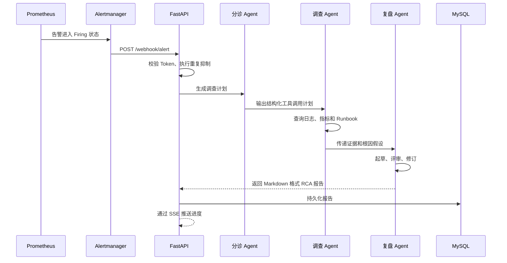

# 架构说明

## 系统定位

本项目是一个事故调查控制面，不负责运行被调查的业务负载。它接收 Prometheus 和 Alertmanager 产生的告警，调用日志、指标和 Runbook 工具收集证据，再通过大模型生成根因分析和复盘报告。

```mermaid
flowchart TB
    subgraph 访问层
        浏览器[浏览器监控台]
        告警管理器[Alertmanager]
    end

    subgraph 应用层
        API[FastAPI 服务]
        认证[Bearer Token / HttpOnly Cookie]
        流水线[三阶段 Agent 流水线]
        SSE[SSE 事件分发]
        指标接口[/metrics 接口]
    end

    subgraph 数据层
        数据库[(MySQL)]
        故障数据[故障样例与 Runbook]
    end

    subgraph 外部依赖
        大模型[OpenAI 兼容模型]
    end

    subgraph 可观测性
        Prometheus
        Grafana
    end

    浏览器 --> 认证 --> API
    告警管理器 -->|带 Token 的 Webhook| API
    API --> 流水线
    流水线 --> 故障数据
    流水线 --> 大模型
    API --> 数据库
    流水线 --> SSE --> 浏览器
    API --> 指标接口 --> Prometheus --> Grafana
    Prometheus --> 告警管理器
```

## 调查数据流



## 主要组件

| 组件 | 职责 | 状态保存位置 |
|---|---|---|
| FastAPI | 认证、事故接口、Webhook、SSE 和指标接口 | 进程内存和 MySQL |
| Agent 流水线 | 制定计划、调查、反思并生成 RCA | 单次请求作用域 |
| MySQL | 用户、Token 哈希和按用户隔离的历史报告 | 持久化磁盘 |
| Prometheus | 采集应用和模拟业务指标 | 持久化时序数据 |
| Alertmanager | 将触发规则发送给应用 | 持久化通知状态 |
| Grafana | 展示服务健康、延迟和调查指标 | 持久化面板配置 |

## 关键可靠性设计

### 数据库启动重试

应用在 FastAPI 启动阶段初始化数据库结构。如果 MySQL 暂时未就绪，会按照配置进行有界重试。`/health` 只表示进程存活，`/ready` 才表示数据库可以正常使用。

这解决了两个问题：

- 数据库启动慢时，应用不会在模块导入阶段直接崩溃。
- Kubernetes 和 Docker 可以区分“进程活着”和“依赖已就绪”。

数据库访问通过连接池复用连接，连接池大小、获取阻塞策略和健康检查由环境变量控制。

### Webhook 幂等处理

每条告警使用 Alertmanager 指纹和 `startsAt` 组成去重键。正在调查的指纹和去重时间窗口内的重复告警会被跳过。

当前去重状态保存在进程内，因此部署基线保持单副本。多副本场景需要将这部分状态迁移到 Redis 或数据库。

### LLM 请求重试

大模型客户端对网络错误、429、5xx 和空响应执行指数退避重试。认证错误、余额不足和模型配置错误不会重试。每次调查还受到总时间预算限制，避免长时间占用调查线程。

### 报告持久化失败

调查完成后，如果 MySQL 写入失败，当前进程内仍会保留报告，并向 SSE 客户端发送 `persistence_warning`。这样不会因为存储故障直接丢失已经消耗模型调用生成的调查结果。

### SSE 实时推送

浏览器和服务器只需要单向通信，因此选择 SSE 而不是 WebSocket。它的实现和运维成本更低，并能通过普通 HTTP Ingress。

Kubernetes Ingress 已关闭代理缓冲并放宽超时时间。服务端使用有界队列向订阅者分发事件，避免慢客户端阻塞调查线程。

## 安全边界

- 密码和安全问题答案使用 PBKDF2-SHA256 加盐哈希。
- Bearer Token 为随机值，数据库只保存 SHA-256 哈希并设置七天有效期。
- 浏览器登录时同时设置 HttpOnly、SameSite=Lax Cookie，SSE 默认通过 Cookie 鉴权。
- 旧 Token 查询参数默认关闭，仅在显式配置 `ALLOW_LEGACY_QUERY_TOKEN=true` 时兼容。
- Webhook 使用共享 Token 和常量时间比较。
- `incident_id` 只允许安全字符，并校验最终路径位于故障样例目录内。
- 应用容器使用 UID 999 运行，根文件系统只读。
- Kubernetes Secret 不提交到仓库，只保留示例模板。
- 手动调查报告按用户隔离，Alertmanager 自动报告使用只读的 `system` 所有者。

## 当前扩展限制

如果需要运行多个应用副本，应先将以下状态迁移到共享服务：

- 告警去重和运行状态迁移到 Redis。
- SSE 广播迁移到 Redis Pub/Sub 或消息队列。
- 会话报告交接改为 MySQL 或对象存储。

MySQL 也需要升级为高可用拓扑。在这些工作完成前，Kubernetes 部署明确保持单副本，不把演示架构包装成生产级高可用方案。
