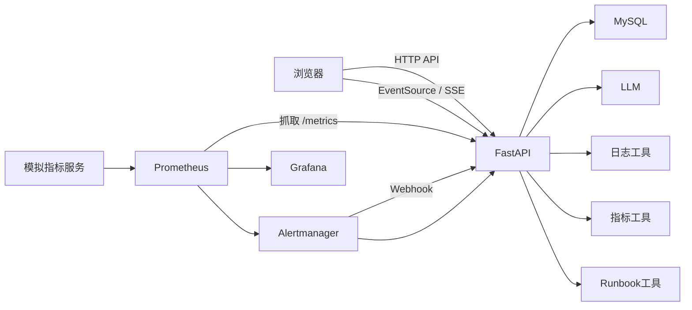

# SRE On-Call Agent 项目完整理解与操作手册

本文档面向第一次接触本项目的开发者，目标是回答四个问题：

1. 这个项目到底解决什么问题。
2. 每个目录和模块分别负责什么。
3. 一次告警调查从浏览器或 Alertmanager 进入后，代码如何逐步执行。
4. 如何启动、演示、排查问题、测试和部署。

建议先完整阅读本文，再按照“快速启动”和“完整演示流程”实际操作一次，最后按照代码阅读顺序深入源码。

## 一、用一句话理解项目

这是一个“AI 辅助事故调查控制面”：

```text
告警进入
  -> 分诊 Agent 制定调查计划
  -> 调查 Agent 调用日志、指标和 Runbook 工具
  -> 复盘 Agent 生成并修订 RCA 报告
  -> SSE 实时展示过程
  -> MySQL 保存历史报告
  -> Prometheus 和 Grafana 监控系统自身
```

它不负责运行业务系统，也不直接替代真实日志平台、监控平台或工单系统。当前日志和指标来自 `data/incidents` 中的故障样例。真实生产接入需要把工具层替换为 Loki、Prometheus、CMDB 或其他数据源。

## 二、项目解决的问题

传统值班流程通常包括：

1. 看到告警后判断影响范围和优先级。
2. 人工查询日志、指标、最近发布和 Runbook。
3. 根据证据形成根因假设。
4. 执行止损措施。
5. 编写事故时间线、根因分析和行动项。

本项目把前三步和复盘部分串成自动化流水线：

- TriageAgent 把原始告警转换为调查计划。
- InvestigationAgent 按计划循环调用工具并收集证据。
- PostmortemAgent 根据事故和证据生成 RCA 报告。
- FastAPI 负责认证、接口、实时推送和持久化。
- Prometheus、Grafana、Docker 和 Kubernetes 负责工程化运行。

## 三、快速启动

### 3.1 Docker Compose 启动方式

这是最推荐的方式，因为一次会启动：

- 应用
- MySQL
- Prometheus
- Alertmanager
- Grafana
- 模拟业务指标服务

第一次启动：

```powershell
Copy-Item .env.example .env
```

编辑 `.env`，至少设置：

```dotenv
LLM_API_KEY=你的模型密钥
LLM_BASE_URL=https://api.example.com/v1
LLM_MODEL_ID=你的模型名称
WEBHOOK_TOKEN=change-this-token
```

启动：

```powershell
docker compose up -d --build
docker compose ps
```

查看应用日志：

```powershell
docker compose logs -f app
```

停止但保留数据：

```powershell
docker compose down
```

停止并删除 MySQL、Prometheus 和 Grafana 数据卷：

```powershell
docker compose down -v
```

最后一条命令会永久删除本地演示数据，只应在确定不需要历史报告时使用。

### 3.2 本地 Python 启动方式

需要本地 MySQL，并提前创建 `sre_agent` 数据库。应用会自动创建表，但不会创建数据库本身。

```powershell
.\.venv\Scripts\python.exe -m pip install -r requirements.txt
$env:MYSQL_HOST = "127.0.0.1"
$env:MYSQL_PORT = "3306"
$env:MYSQL_USER = "root"
$env:MYSQL_PASSWORD = "你的密码"
$env:MYSQL_DB = "sre_agent"
.\.venv\Scripts\python.exe -m uvicorn src.api.main:app --reload --port 8000
```

本地运行时，Prometheus、Grafana 和 Alertmanager 需要自行启动；只有 FastAPI 和 MySQL 是本项目启动的必要条件。

### 3.3 启动后的访问地址

| 服务 | 地址 |
|---|---|
| 应用监控台 | `http://localhost:8000` |
| 登录页 | `http://localhost:8000/login.html` |
| OpenAPI 文档 | `http://localhost:8000/docs` |
| Prometheus | `http://localhost:9090` |
| Alertmanager | `http://localhost:9093` |
| Grafana | `http://localhost:3000` |
| 模拟指标 | `http://localhost:8001/metrics` |

## 四、系统整体架构



### 4.1 系统内部与外部的边界

| 层 | 负责内容 | 不负责内容 |
|---|---|---|
| 浏览器前端 | 登录、选择事故、展示 SSE、查看历史报告 | 不直接调用大模型 |
| FastAPI | 认证、API、事务编排、SSE、告警接入、监控指标 | 不运行被调查的业务系统 |
| Agent 流水线 | 计划、工具调用、证据整合、RCA 生成 | 不负责持久化和用户认证 |
| 工具层 | 查询日志、指标和 Runbook | 不负责决定下一步调查 |
| MySQL | 用户、Token、历史报告 | 不保存运行中的 SSE 连接 |
| Prometheus | 采集应用指标和模拟业务指标 | 不做事故根因分析 |
| Alertmanager | 路由和发送告警 | 不生成 RCA |
| Kubernetes | 调度、探针、扩缩容和服务发现 | 不替代应用内部幂等和共享状态设计 |

### 4.2 三种核心请求流

#### 浏览器手动调查

```text
登录页 -> /auth/login -> localStorage 保存 Token，同时设置 HttpOnly Cookie
监控台 -> /auth/session -> 用 Bearer Token 刷新 Cookie
监控台 -> /incidents/investigate/stream?incident_id=...
FastAPI -> run_pipeline
FastAPI -> SSE 推送 stage/plan/step/report/done
浏览器 -> 更新卡片、进度条和 Markdown 报告
FastAPI -> MySQL 保存完整结果
```

#### Alertmanager 自动调查

```text
模拟指标 -> Prometheus 规则 -> Alertmanager
Alertmanager -> POST /webhook/alert
FastAPI -> 校验 Token -> 指纹去重 -> 后台线程执行 run_pipeline
FastAPI -> 广播 alert 事件到 /webhook/events
FastAPI -> MySQL 保存报告
```

当前监控台主要订阅单次调查的 `/incidents/investigate/stream`。自动告警事件接口已经存在，但还没有独立的前端告警事件面板。

#### 历史报告读取

```text
浏览器 -> GET /incidents/reports
FastAPI -> 查询 MySQL 元数据
浏览器 -> GET /incidents/reports/{id}
FastAPI -> 读取 payload JSON -> 返回完整报告
浏览器 -> 渲染 Markdown
```

## 五、目录与文件总览

```text
SREOnCallAgent/
├─ src/
│  ├─ api/                 FastAPI 接口、认证、数据库和指标
│  ├─ agents/              Triage、Investigation、Postmortem 和流水线
│  ├─ core/                大模型客户端
│  └─ tools/               日志、指标和 Runbook 工具
├─ static/                 登录页和监控台前端
├─ data/
│  ├─ incidents/           故障样例 JSON
│  └─ runbooks/            服务 Runbook YAML
├─ docker/                 Prometheus、Alertmanager、Grafana 和模拟指标
├─ deploy/k8s/             Kubernetes/Kustomize 资源
├─ tests/                  pytest 单元测试和接口测试
├─ docs/                   架构、运维、演练和面试文档
├─ Dockerfile
├─ docker-compose.yml
├─ requirements.txt
└─ requirements-dev.txt
```

## 六、后端 API 模块

### 6.1 `src/api/main.py`

这是应用入口和总编排文件，负责把认证、数据库、Agent、SSE、Webhook 和监控连接在一起。

#### 应用生命周期

`lifespan` 在 FastAPI 启动和关闭时执行：

1. 调用 `db.init_db_with_retry()`，初始化表并等待 MySQL 就绪。
2. 调用 `cleanup_expired_tokens()`，清理过期登录 Token。
3. 自动增加新字段，并把旧明文 Token 迁移为 SHA-256 哈希。
4. 检查生产环境是否仍使用默认或非法 Webhook Token。
5. 保存事件循环对象，供后台线程向 SSE 队列投递事件。
6. 应用关闭时清空事件循环引用并关闭 MySQL 连接池。

这一实现解决了“容器已启动但 MySQL 还没启动”的启动顺序问题。

#### 中间件

| 中间件 | 作用 |
|---|---|
| `no_cache_static` | 给页面和静态资源添加 `no-store`，避免前端更新后仍加载旧文件 |
| `prometheus_http_metrics` | 统计请求数量、状态码、延迟和正在处理的请求数 |

指标中间件使用 FastAPI 路由模板作为路径标签，例如 `/incidents/reports/{rid}`，避免把每个具体 ID 都变成独立指标，防止标签基数膨胀。

#### 内存状态

`main.py` 中使用了几组进程内状态：

| 变量 | 作用 | 多副本风险 |
|---|---|---|
| `_report_store` | 以 `(用户名, 事故 ID)` 保存当前进程的报告 | 请求落到其他副本时可能读不到 |
| `_alert_running` | 标记正在执行的告警指纹 | 不同副本可能重复调查 |
| `_alert_seen` | 保存去重时间窗口内的告警键 | 不同副本无法共享 |
| `_alert_subscribers` | 保存 `/webhook/events` 的 SSE 队列 | 事件不会跨副本广播 |

因此 Kubernetes 基线只运行一个应用副本。

#### 基础接口

| 接口 | 实现 |
|---|---|
| `GET /` | 返回 `static/index.html` |
| `GET /login.html` | 返回登录页 |
| `GET /health` | 只检查 FastAPI 进程是否响应 |
| `GET /ready` | 执行 MySQL 简单查询，失败返回 503 |
| `GET /metrics` | 返回 Prometheus 文本格式指标 |
| `GET /llm/check` | 创建 LLM 客户端并发送一次最小请求 |

#### 事故接口

| 接口 | 实现 |
|---|---|
| `GET /incidents/fixtures` | 扫描 `data/incidents/*.json` |
| `POST /incidents/investigate` | 同步执行完整 Agent 流水线 |
| `GET /incidents/investigate/stream` | 在后台任务中执行流水线，通过 SSE 推送 |
| `GET /incidents/{id}/report` | 从当前进程的 `_report_store` 读取 |
| `GET /incidents/reports` | 分页读取当前用户和系统报告，可按关键词搜索 |
| `GET /incidents/reports/{rid}` | 按数据库 ID 读取并解析完整 payload |
| `DELETE /incidents/reports/{rid}` | 删除单条历史报告 |
| `DELETE /incidents/reports` | 清空当前用户的历史报告 |

#### 报告持久化

`_save_report()` 将完整结果序列化为 JSON，写入 `reports.payload`。

`_persist_report()` 会捕获数据库写入异常，并向前端发送 `persistence_warning`。这样即使数据库暂时不可用，当前进程内已经生成的报告也不会立即丢失。

#### SSE 格式

`_sse()` 将字典转换为标准 SSE：

```text
data: {"type":"stage","stage":1,...}
```

普通调查流通过 `asyncio.Queue` 把后台线程产生的事件传回异步生成器，并每 15 秒发送一次 keep-alive。

#### Alertmanager Webhook

告警处理链路如下：

1. 校验 `X-Webhook-Token`。
2. 忽略非 `firing` 告警。
3. 将 Alertmanager 告警转换成项目内部事故结构。
4. 使用指纹和 `startsAt` 生成去重键。
5. 启动后台线程执行三阶段流水线。
6. 将进度广播到告警 SSE 订阅者。
7. 将结果保存到 MySQL。

#### API 路由顺序和静态资源

API 路由先注册，`/static` 最后挂载。这样可以避免静态资源路由覆盖后端接口。

### 6.2 `src/api/auth.py`

负责用户注册、登录、Token 校验、退出登录和密码找回。

#### 密码存储

- 密码使用 PBKDF2-SHA256。
- 每个用户生成 16 字节随机盐。
- 迭代次数为 100000。
- 数据库只保存哈希和盐，不保存明文密码。
- 安全问题答案同样哈希，比较时忽略前后空格和大小写。

#### Token

- 登录成功后生成 32 字节随机值，转换为 64 位十六进制字符串。
- 数据库只保存 Token 的 SHA-256 哈希，不保存客户端持有的原始 Token。
- 登录同时设置 HttpOnly、SameSite=Lax 的 `sre_session` Cookie。
- 旧库中的明文 Token 会在启动时自动转为哈希。
- 默认有效期为 7 天。
- 退出登录删除当前 Token。
- 重置密码会删除该用户全部 Token。
- 应用启动时清理过期 Token。

#### 认证依赖

`get_current_user()` 从以下位置读取 Token：

1. `Authorization: Bearer <token>`。
2. HttpOnly Cookie `sre_session`。
3. 只有显式开启兼容时才读取旧查询参数 `?token=...`。

浏览器原生 `EventSource` 不能设置自定义请求头，因此前端在建立 SSE 前调用 `/auth/session` 刷新 Cookie。查询参数鉴权默认关闭，避免长期 Token 进入代理访问日志。

#### 用户接口

| 接口 | 说明 |
|---|---|
| `POST /auth/register` | 检查重名，保存密码哈希和安全问题 |
| `POST /auth/login` | 校验密码，生成 Token |
| `POST /auth/logout` | 删除当前 Token |
| `GET /auth/me` | 验证 Token 返回用户名 |
| `POST /auth/session` | 用 Bearer Token 刷新 HttpOnly Cookie |
| `POST /auth/forgot/question` | 返回安全问题 |
| `POST /auth/forgot/reset` | 校验答案并重置密码 |

### 6.3 `src/api/db.py`

负责 MySQL 连接池、查询、写入、建表、索引和兼容迁移。

#### 连接方式

应用使用 DBUtils `PooledDB` 管理连接。`query()` 和 `execute()` 从连接池借用连接，执行结束后归还，避免每次查询都新建物理连接。连接池最小缓存、最大缓存和最大连接数均可配置。

连接参数来自：

```text
MYSQL_HOST
MYSQL_PORT
MYSQL_USER
MYSQL_PASSWORD
MYSQL_DB
MYSQL_CONNECT_TIMEOUT
MYSQL_READ_TIMEOUT
MYSQL_WRITE_TIMEOUT
MYSQL_POOL_MIN_CACHED
MYSQL_POOL_MAX_CACHED
MYSQL_POOL_MAX_CONNECTIONS
```

#### 数据表

| 表 | 主要字段 | 用途 |
|---|---|---|
| `users` | `username`, `password_hash`, `salt`, `question`, `answer_hash` | 用户和安全问题 |
| `tokens` | `token`, `username`, `created_at`, `is_hashed` | Token 哈希 |
| `reports` | `incident_id`, `service`, `severity`, `owner_username`, `created_at`, `payload` | 按用户隔离的历史报告 |

#### 索引

- Token 用户名字段。
- 报告事故 ID。
- 报告服务名。
- 报告严重级别。
- 报告创建时间。
- 报告所有者。

`_ensure_index()` 会先查询 `information_schema.statistics`，只对缺失索引执行创建，兼容旧数据库。

#### 启动重试

`init_db_with_retry()` 读取：

```text
DB_INIT_MAX_ATTEMPTS
DB_INIT_RETRY_SECONDS
```

默认最多尝试 30 次，每次间隔 2 秒。测试中会缩短这些参数，避免等待。

### 6.4 `src/api/metrics.py`

定义 Prometheus 指标对象：

| 指标 | 类型 | 含义 |
|---|---|---|
| `sre_http_requests_total` | Counter | 按方法、路径和状态码统计请求 |
| `sre_http_request_duration_seconds` | Histogram | HTTP 请求耗时 |
| `sre_http_requests_in_progress` | Gauge | 当前处理中的请求 |
| `sre_alerts_received_total` | Counter | 接受、重复和忽略的告警 |
| `sre_investigations_total` | Counter | 按触发来源和结果统计调查 |
| `sre_investigation_duration_seconds` | Histogram | 完整调查耗时 |
| `sre_investigations_in_progress` | Gauge | 当前运行中的调查数量 |

触发来源包括：

- `manual`：同步手动调用。
- `stream`：页面 SSE 调查。
- `alertmanager`：自动告警调查。

## 七、大模型客户端

### 7.1 `src/core/llm_client.py`

`HelloAgentsLLM` 封装任意 OpenAI 兼容接口。

#### 初始化

从环境变量读取：

```text
LLM_API_KEY
LLM_BASE_URL
LLM_MODEL_ID
LLM_TIMEOUT
LLM_MAX_RETRIES
LLM_RETRY_BASE_SECONDS
LLM_REQUEST_BUDGET_SECONDS
```

三项必填，缺少时抛出 `ValueError`。

#### `think()`

接收 OpenAI 格式的 messages，使用流式请求收集模型输出。实现包含：

1. 对网络错误、429、5xx 和空响应进行有界重试。
2. 使用指数退避和随机抖动，避免同时重试造成二次冲击。
3. 认证错误、余额不足和模型不存在等错误不重试。
4. 使用 `LLM_REQUEST_BUDGET_SECONDS` 控制一次调用的总时间上限。
5. 所有重试仍失败时抛出 `LLMError`，由调查流向前端返回明确错误。

#### `check()`

发送一条最小请求，返回：

- 是否成功。
- 模型名称。
- 接口地址。
- 响应延迟。
- 错误分类和中文提示。

#### 错误分类

`classify_llm_error()` 将错误分成：

- 认证错误。
- 余额不足。
- 限流。
- 模型不存在。
- 服务端错误。
- 网络错误。
- 网关会话错误。
- 未知错误。

## 八、Agent 模块

### 8.1 `src/agents/pipeline.py`

这是 Agent 流水线的总入口。

#### 故障数据加载

- `list_incidents()` 扫描 JSON 文件并排序。
- `load_incident()` 校验 ID 格式。
- ID 只允许字母、数字、下划线和短横线，最长 64。
- 最终解析路径必须位于 `data/incidents` 下，防止路径穿越。

#### `run_pipeline()`

执行顺序：

```text
加载事故
-> 创建 LLM
-> TriageAgent.run()
-> InvestigationAgent.run()
-> PostmortemAgent.run()
-> 组装统一结果
-> 发送 report 事件
```

返回结构：

```json
{
  "incident_id": "db_pool_exhaustion",
  "service": "checkout-service",
  "severity": "P1",
  "owner_username": "demo-user",
  "plan": [],
  "findings": {},
  "report": "Markdown RCA"
}
```

### 8.2 `src/agents/triage_agent.py`

负责 Plan-and-Solve 阶段。

#### 输入

- 事故 ID。
- 服务名。
- 严重级别。
- 告警指标、数值、阈值、时间和描述。

#### 实现

1. 生成包含事故摘要的中文调查提示词。
2. 要求模型只输出 Python 列表代码块。
3. 使用 `ast.literal_eval()` 解析列表。
4. 确认解析结果是字典列表，后续流水线再读取 `tool`、`query` 和 `reason`。
5. 解析失败时使用固定兜底计划。
6. 通过 emit 发送 `plan` 事件。

计划步骤示例：

```json
{
  "tool": "metric_query",
  "query": "db_pool",
  "reason": "检查数据库连接池饱和度"
}
```

### 8.3 `src/agents/investigation_agent.py`

负责 ReAct 调查阶段。

#### 初始化

创建三个工具：

- `LogSearchTool`
- `MetricQueryTool`
- `RunbookLookupTool`

#### 调查循环

最多执行 12 步：

1. 将事故摘要、计划、工具描述和历史记录拼成提示词。
2. 调用模型。
3. 解析 `Thought:` 和 `Action:`。
4. 如果 Action 是 `Finish[...]`，记录根因并结束。
5. 如果 Action 是 `tool_name[query]`，调用对应工具。
6. 将 Action 和 Observation 加入历史。
7. 日志和指标结果加入 evidence。
8. Runbook 结果加入 runbook_steps。
9. 相同工具和相同查询只执行一次。
10. 每一步通过 SSE 发送 `step` 事件。

#### 关键边界

- 未知工具会返回错误观察结果。
- 无法解析 Action 时停止。
- 模型返回空字符串时停止。
- 达到最大步骤仍未 Finish 时，返回当前证据和已识别的根因。

### 8.4 `src/agents/postmortem_agent.py`

负责 Reflection 复盘阶段。

#### 草稿

将以下内容交给模型：

- 事故摘要。
- 根因。
- 工具证据。
- Runbook 内容。

要求输出固定章节：

1. 执行摘要。
2. 事故时间线。
3. 根因分析。
4. 影响评估。
5. 立即修复措施。
6. 行动项。
7. 经验教训。

#### 评审

模型返回 JSON：

```json
{
  "score": 7,
  "issues": ["缺少时间线"],
  "suggestions": ["补充关键日志时间"]
}
```

`_extract_score()` 从文本中提取分数。分数低于 8 时会要求模型修订，默认最多修订一次。

#### 输出

最终返回 Markdown 文本。`run_pipeline()` 再通过 `report` 事件发送给前端。

## 九、工具层

### 9.1 `src/tools/log_search_tool.py`

在事故 JSON 的 `logs` 数组中搜索。

- 支持正则表达式。
- 忽略大小写。
- 正则非法时退化为普通字符串匹配。
- 同时搜索日志级别和日志消息。
- 没找到时返回明确的 `No log entries found` 文本。

### 9.2 `src/tools/metric_query_tool.py`

在事故 JSON 的 `metrics` 对象中按名称子串过滤。

例如输入 `db_pool` 可以匹配：

```text
db_pool_active_connections
db_pool_wait_seconds
```

结果按时间点排序后格式化为文本。

### 9.3 `src/tools/runbook_tool.py`

从 `data/runbooks` 中加载 YAML。

加载逻辑：

1. 优先读取与事故服务同名的文件。
2. 找不到时扫描目录并按服务名模糊匹配。
3. 按 error pattern 查找 procedure。
4. 找不到具体 pattern 时返回该服务全部 procedure。

## 十、故障数据和 Runbook

### 10.1 `data/incidents`

| 文件 | 服务 | 故障 |
|---|---|---|
| `db_pool_exhaustion.json` | checkout-service | 缺少索引导致全表扫描，最终连接池耗尽 |
| `memory_leak_oom.json` | auth-service | 会话缓存没有 TTL 和淘汰策略 |
| `external_api_ratelimit.json` | payment-service | 无指数退避，重试风暴放大外部限流 |

事故 JSON 主要字段：

```json
{
  "incident_id": "INC-001",
  "service": "checkout-service",
  "severity": "P1",
  "alert": {
    "metric": "http_request_duration_p99",
    "value": 8.3,
    "threshold": 1.0,
    "unit": "seconds",
    "timestamp": "2024-01-15T14:03:22Z",
    "description": "P99 latency exceeds SLO"
  },
  "logs": [],
  "metrics": {},
  "root_cause": "Known fixture root cause",
  "affected_users": 2847
}
```

注意：JSON 中的 `root_cause` 是样例答案，不会被 InvestigationAgent 直接读取；Agent 仍然需要通过日志、指标和 Runbook 推理。

### 10.2 `data/runbooks`

当前有两份 Runbook：

- `checkout-service.yaml`
- `payment-service.yaml`

每份包含多个 pattern 和处理步骤，Runbook 内容会被注入复盘报告提示词。

### 10.3 新增故障样例

1. 在 `data/incidents` 新建合法 ID 的 JSON 文件。
2. 填写告警、日志、指标和影响用户数。
3. 如果使用 Docker，需要重新构建镜像，因为数据会复制进镜像。
4. 重启或重新部署应用。
5. 调用 `/incidents/fixtures` 确认已发现。

## 十一、前端模块

### 11.1 `static/login.html` 与 `static/login.js`

登录页包含三个视图：

- 登录。
- 注册。
- 安全问题找回密码。

`login.js` 负责：

- 调用认证 API。
- 保存 `sre_token` 和 `sre_username` 到 localStorage。
- 已登录用户直接跳转监控台。
- 展示后端返回的错误信息。

### 11.2 `static/index.html`

监控台页面包括：

- 顶部服务状态和 LLM 检测按钮。
- 左侧事故样例。
- 左侧历史报告搜索和管理。
- 中央多调查卡片。
- 自动滚动开关。

### 11.3 `static/app.js`

前端核心状态：

```javascript
state = {
  currentId,              // 当前选择的事故
  nextRunId,              // 本地卡片编号
  runs,                   // 正在显示的全部调查
  runningByIncident,      // 防止同一事故重复执行
  reportOffset,           // 当前分页偏移
  reportTotal,            // 历史报告总数
  reportKeyword           // 当前搜索词
}
```

主要函数：

| 函数 | 作用 |
|---|---|
| `authFetch()` | 自动添加 Bearer Token，401 时返回登录页 |
| `checkAuth()` | 检查本地 Token |
| `createRunCard()` | 创建调查卡片 |
| `handleEvent()` | 按 SSE 事件类型更新进度和日志 |
| `runInvestigation()` | 刷新 Cookie 后创建 EventSource 并订阅调查流 |
| `loadIncidents()` | 获取故障样例 |
| `loadReports()` | 分页获取当前用户和系统报告，并支持加载更多 |
| `loadReport()` | 打开历史报告，重复打开时聚焦已有卡片 |
| `renderMarkdown()` | 项目内置的简化 Markdown 渲染器 |
| `checkLLM()` | 调用 `/llm/check` |
| `pollHealth()` | 每 15 秒检查 `/health` |

SSE 事件处理：

| 事件 | 前端行为 |
|---|---|
| `start` | 初始化调查卡片 |
| `stage` | 更新阶段和进度 |
| `plan` | 展示调查计划 |
| `step` | 展示 Thought、Action、Observation |
| `root_cause` | 展示根因结论 |
| `draft` | 提示草稿完成 |
| `critique` | 展示质量评分 |
| `revise` | 提示修订完成 |
| `report` | 渲染 Markdown 报告 |
| `error` | 展示调查错误 |
| `done` | 关闭 EventSource、刷新历史报告 |

### 11.4 `static/style.css`

负责监控台、登录页、调查卡片、状态徽章、进度条、表格、代码块和响应式布局。

### 11.5 `project-guide.html`

这是一个独立打开的项目全景 HTML 页面，不属于 FastAPI 运行时功能，也不影响后端。它通过浏览器直接打开，主要用于可视化说明项目。

## 十二、核心数据结构

### 12.1 调查计划

```json
[
  {
    "tool": "log_search",
    "query": "pool exhausted",
    "reason": "定位连接池耗尽日志"
  }
]
```

### 12.2 调查发现

```json
{
  "evidence": [
    {
      "tool": "metric_query",
      "query": "db_pool",
      "result": "..."
    }
  ],
  "root_cause": "Missing index caused full table scans",
  "runbook_steps": ["..."]
}
```

### 12.3 历史报告记录

```json
{
  "id": 1,
  "incident_id": "db_pool_exhaustion",
  "service": "checkout-service",
  "severity": "P1",
  "created_at": "2026-10-28 15:00:00",
  "payload": {
    "incident_id": "db_pool_exhaustion",
    "plan": [],
    "findings": {},
    "report": "Markdown"
  }
}
```

## 十三、API 操作指南

### 13.1 注册和登录

```bash
curl -X POST http://localhost:8000/auth/register \
  -H "Content-Type: application/json" \
  -d '{
    "username":"demo-user",
    "password":"demo-pass-123",
    "question":"安全问题",
    "answer":"答案"
  }'

curl -X POST http://localhost:8000/auth/login \
  -H "Content-Type: application/json" \
  -d '{"username":"demo-user","password":"demo-pass-123"}'
```

登录响应中的 `token` 用于后续接口，同时浏览器会收到 HttpOnly `sre_session` Cookie。手动报告归属于当前用户；Alertmanager 自动报告归属于只读的 `system`，所有登录用户可以查看但不能删除。

### 13.2 查询样例和运行调查

```bash
curl http://localhost:8000/incidents/fixtures \
  -H "Authorization: Bearer YOUR_TOKEN"

curl -N "http://localhost:8000/incidents/investigate/stream?incident_id=db_pool_exhaustion" \
  -H "Authorization: Bearer YOUR_TOKEN"
```

### 13.3 查询历史报告

```bash
curl "http://localhost:8000/incidents/reports?keyword=checkout&limit=20&offset=0" \
  -H "Authorization: Bearer YOUR_TOKEN"

curl http://localhost:8000/incidents/reports/1 \
  -H "Authorization: Bearer YOUR_TOKEN"
```

### 13.4 手动发送 Webhook

```bash
curl -X POST http://localhost:8000/webhook/alert \
  -H "Content-Type: application/json" \
  -H "X-Webhook-Token: $WEBHOOK_TOKEN" \
  -d '{
    "version":"4",
    "groupKey":"demo",
    "status":"firing",
    "commonLabels":{
      "alertname":"HighLatency",
      "service":"checkout-service",
      "severity":"P1"
    },
    "commonAnnotations":{
      "description":"P99 latency is high"
    },
    "alerts":[{
      "status":"firing",
      "startsAt":"2026-10-28T10:00:00Z",
      "fingerprint":"manual-demo"
    }]
  }'
```

如果返回 `started`，表示自动调查已进入后台。

## 十四、Docker 与 Compose 模块

### 14.1 `Dockerfile`

主要步骤：

1. 使用 `python:3.12-slim`。
2. 关闭 Python 字节码写入，开启无缓冲日志。
3. 创建非 root 用户 `app`。
4. 安装生产依赖。
5. 只复制 `src`、`static` 和 `data`。
6. 使用 UID 999 启动。
7. 暴露 8000 端口并配置健康检查。

### 14.2 `docker-compose.yml`

| 服务 | 作用 |
|---|---|
| `mysql` | 保存用户、Token 和历史报告 |
| `app` | FastAPI 应用 |
| `demo-exporter` | 模拟三个业务服务的指标 |
| `prometheus` | 抓取应用和模拟指标 |
| `alertmanager` | 将告警发送到应用 |
| `grafana` | 展示预配置 Dashboard |

Compose 使用命名卷：

- `mysql-data`
- `prometheus-data`
- `grafana-data`

Alertmanager 容器启动时会把模板中的 `__WEBHOOK_TOKEN__` 替换成运行时环境变量，避免应用和 Alertmanager 使用不同 Token。

## 十五、可观测性模块

### 15.1 `docker/prometheus.yml`

抓取两个目标：

```text
app:8000/metrics
demo-exporter:8001/metrics
```

### 15.2 `docker/prometheus_rules.yml`

应用规则：

- `SreOnCallAgentDown`
- `SreOnCallAgentHigh5xxRate`
- `SreOnCallAgentHighLatency`
- `SreInvestigationFailures`

模拟业务规则：

- `DBConnectionPoolSaturation`
- `PodMemoryHigh`
- `PaymentSuccessRateLow`

### 15.3 `docker/alertmanager.yml`

- 按 `alertname` 和 `service` 分组。
- `group_wait` 为 5 秒。
- `repeat_interval` 为 5 分钟。
- 只发送 firing，不发送 resolved。
- 使用 `X-Webhook-Token` 调用应用。

### 15.4 Grafana

Dashboard UID 为 `sre-oncall-agent`，包含：

- 应用健康。
- 请求速率。
- 5xx 比例。
- P50/P95 延迟。
- 调查吞吐。
- 正在执行的调查。
- 告警处理结果。

## 十六、Kubernetes 模块

部署目录为 `deploy/k8s`。

| 文件 | 作用 |
|---|---|
| `namespace.yaml` | 创建 `sre-oncall` 命名空间 |
| `configmap.yaml` | 非敏感运行配置 |
| `secret.example.yaml` | Secret 字段示例，不直接使用占位值 |
| `mysql.yaml` | MySQL StatefulSet、Headless Service 和 PVC |
| `app.yaml` | 应用 Deployment、Service 和安全上下文 |
| `ingress.yaml` | ingress-nginx 入口和 SSE 长连接配置 |
| `kustomization.yaml` | 统一渲染资源 |
| `kind-config.yaml` | 三节点 Kind 集群 |

应用探针：

- Startup：`/ready`，最多等待约 150 秒。
- Readiness：`/ready`。
- Liveness：`/health`。

安全设置：

- UID/GID 999。
- 禁止权限提升。
- 根文件系统只读。
- 删除全部 Linux capabilities。
- 只挂载 64Mi 临时目录。

常用操作：

```bash
kubectl apply -k deploy/k8s
kubectl -n sre-oncall get pods,svc,pvc
kubectl -n sre-oncall logs deployment/sre-oncall-agent
kubectl -n sre-oncall describe pod -l app.kubernetes.io/name=sre-oncall-agent
kubectl -n sre-oncall rollout restart deployment/sre-oncall-agent
```

完整步骤见 [Kubernetes 部署说明](../deploy/k8s/README.md)。

## 十七、测试与 CI

### 17.1 测试文件

| 文件 | 覆盖内容 |
|---|---|
| `tests/test_auth.py` | 密码哈希、Token 哈希迁移、Cookie、过期与清理 |
| `tests/test_db.py` | 连接池、字典游标、数据库重试和就绪检查 |
| `tests/test_api.py` | 鉴权、报告隔离、分页、事故接口和指标 |
| `tests/test_alert_webhook.py` | Token、去重、Resolved 忽略、告警转换、持久化失败 |
| `tests/test_pipeline_and_tools.py` | 路径安全、数据加载、流水线编排、三个工具 |
| `tests/test_agents.py` | Agent 解析、证据收集、修订和 LLM 重试 |

运行测试：

```powershell
.\.venv\Scripts\python.exe -m pytest -q
```

覆盖率：

```powershell
.\.venv\Scripts\python.exe -m pytest `
  --cov=src `
  --cov-report=term-missing `
  --cov-fail-under=70
```

当前结果约为 53 个测试、77% 覆盖率。

### 17.2 GitHub Actions

`.github/workflows/ci.yml` 包含三个任务：

1. Python 测试和覆盖率门槛。
2. Docker Compose 配置和 Kubernetes 渲染检查。
3. Docker 镜像构建。

## 十八、完整演示流程

建议按以下顺序演示：

### 第一步：启动

```powershell
docker compose up -d --build
docker compose ps
```

确认所有服务为 healthy 或 running。

### 第二步：检查基础健康

```powershell
Invoke-RestMethod http://localhost:8000/health
Invoke-RestMethod http://localhost:8000/ready
```

打开 Prometheus，确认 `sre-oncall-agent` 和 `demo-exporter` 两个目标都是 `up`。

### 第三步：注册和登录

打开 `http://localhost:8000/login.html`：

1. 注册账号。
2. 设置安全问题和答案。
3. 登录。

### 第四步：检测 LLM

在监控台点击“检测大模型”，确认模型、接口和延迟正常。

### 第五步：执行事故调查

1. 选择 `db_pool_exhaustion`。
2. 点击“开始调查”。
3. 观察阶段、计划、Thought、Action、Observation、根因和复盘报告。
4. 刷新或等待历史报告列表更新。

### 第六步：查看历史报告

点击历史报告，应打开新的报告卡片。重复点击同一条记录时应聚焦原卡片，而不是重复创建。

### 第七步：查看监控

打开 Grafana：

```text
http://localhost:3000/d/sre-oncall-agent
```

检查请求速率、延迟、5xx 和调查吞吐是否变化。

### 第八步：执行一个故障演练

可以按 [故障演练手册](fault-drills.md) 停止 MySQL、发送重复 Webhook 或验证 Kubernetes Pod 自愈。

## 十九、常见问题排查

### 19.1 应用启动失败

```powershell
docker compose logs app
docker compose ps mysql
```

重点检查：

- MySQL 是否 healthy。
- `MYSQL_USER`、`MYSQL_PASSWORD`、`MYSQL_DB` 是否一致。
- `WEBHOOK_TOKEN` 是否包含非法字符。
- 生产环境是否仍使用默认 Webhook Token。

### 19.2 `/ready` 返回 503

```powershell
docker compose logs app
docker exec sre-oncall-monitoring-mysql-1 mysql \
  -usre -psre_dev_password -e "SELECT 1"
```

检查数据库容器、账号密码、网络和数据库初始化错误。

### 19.3 调查没有输出

1. 点击“检测大模型”。
2. 检查 `LLM_API_KEY`。
3. 检查 `LLM_BASE_URL` 是否可访问。
4. 检查 `LLM_MODEL_ID` 是否有效。
5. 查看 app 日志。

### 19.4 SSE 没有事件

- 浏览器开发者工具查看 EventSource 请求。
- 确认 Token 有效。
- 确认代理没有缓冲 SSE。
- Nginx 需要 `proxy-buffering: off` 和足够长的超时时间。

### 19.5 报告没有出现在历史列表

- 检查 MySQL 写入日志。
- 检查是否存在 `persistence_warning`。
- 检查 `reports` 表。
- 检查浏览器是否仍使用旧 Token。

### 19.6 Prometheus 没有应用指标

```bash
curl http://app:8000/metrics
```

确认 Prometheus 配置中的目标为 `app:8000`。如果修改了配置，需要重启或热加载 Prometheus。

## 二十、代码阅读顺序

建议按以下顺序阅读：

1. `data/incidents/db_pool_exhaustion.json`：先理解输入。
2. `src/tools`：理解 Agent 可以查询什么。
3. `src/agents/triage_agent.py`：理解如何生成计划。
4. `src/agents/investigation_agent.py`：理解 ReAct 循环。
5. `src/agents/postmortem_agent.py`：理解 Reflection。
6. `src/agents/pipeline.py`：理解三阶段如何串联。
7. `src/api/main.py`：理解 API、SSE、Webhook 和持久化。
8. `static/app.js`：理解前端如何消费 SSE。
9. `tests`：理解每个关键边界如何验证。
10. `docker-compose.yml` 和 `deploy/k8s`：理解部署和运维。

## 二十一、如何新增一个工具

1. 在 `src/tools` 新建工具类。
2. 提供 `name`、`description` 和 `run(query)`。
3. 在 `InvestigationAgent.__init__()` 注册工具。
4. 更新 ReAct 提示词中的工具说明。
5. 在 `_execute_tool()` 中决定哪些结果加入 evidence。
6. 增加工具单元测试。
7. 在 Triage 提示词中说明可用工具。
8. 添加一个能触发该工具的故障样例。

## 二十二、如何新增一个 Agent 阶段

1. 新建 Agent 类和提示词。
2. 明确输入、输出和 SSE 事件类型。
3. 在 `run_pipeline()` 中调整执行顺序。
4. 更新结果数据结构和前端事件处理。
5. 为阶段输入输出增加测试。
6. 在架构文档和本手册中更新流程。

## 二十三、当前限制

### 23.1 状态限制

- SSE 订阅、告警去重和会话报告在进程内。
- 应用只能单副本运行。
- 多副本前必须迁移到 Redis 或数据库。

### 23.2 数据限制

- 日志和指标是样例。
- 尚未接入 Loki、CloudWatch、Datadog 或 Kubernetes 实时日志。
- 报告搜索使用 `LIKE %keyword%`，数据量大时需要全文索引或搜索引擎。

### 23.3 数据库限制

- MySQL 是单实例，不具备生产级高可用。
- 没有数据库迁移工具，结构变更依赖启动时初始化。

### 23.4 安全限制

- 没有登录限流、验证码、审计日志和权限角色。
- 当前认证适合教学和内部演示，不适合直接面向公网。
- `SESSION_COOKIE_SECURE` 默认关闭以兼容本地 HTTP；HTTPS 部署必须开启。

### 23.5 工程限制

- 没有后台任务队列，长时间调查依赖线程和进程内事件。
- 应用崩溃会丢失正在进行的调查。
- 没有 LLM 熔断器和按 Token 计费的成本预算。
- SQLite 时代的历史报告保留在数据库中，但默认标记为 `legacy`，不会显示给普通用户。

## 二十四、后续演进方向

建议优先级：

1. Redis 共享告警锁、运行状态和 SSE 广播。
2. 独立工作队列和调查任务状态表。
3. Loki 和真实 Kubernetes 指标接入。
4. 用户角色、审计日志和登录限流。
5. 大模型熔断器和成本统计。
6. Alembic 数据库迁移工具和 MySQL 高可用。
7. HPA、PodDisruptionBudget 和 NetworkPolicy。

## 二十五、相关文档

- [项目 README](../README.md)
- [架构说明](architecture.md)
- [运维 Runbook](runbooks/sre-oncall-agent.md)
- [故障演练](fault-drills.md)
- [面试演示指南](interview-guide.md)
- [功能验证测试文档](feature-acceptance-test.md)
- [Kubernetes 部署](../deploy/k8s/README.md)
